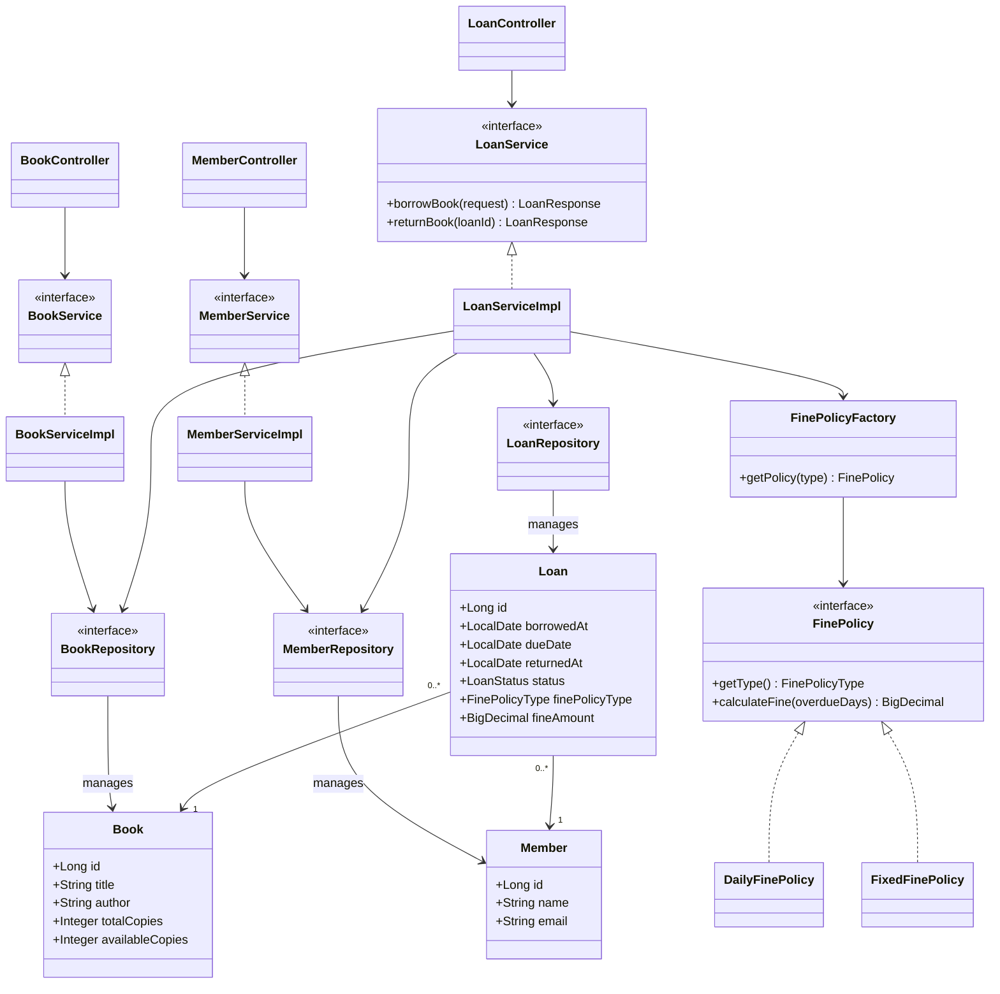

# Library Management — SOLID Assignment

Ứng dụng quản lý thư viện đơn giản xây dựng bằng **Java / Spring Boot**, tập trung vào thiết kế theo nguyên lý **SOLID**.

## Chức năng

- **Thêm sách:** tạo `Book` với tên sách, tác giả và số lượng.
- **Mượn sách:** `LoanService.borrowBook()` kiểm tra thành viên và số lượng còn lại, tạo `Loan`, giảm `availableCopies`.
- **Trả sách:** `LoanService.returnBook()` cập nhật trạng thái `RETURNED`, tăng `availableCopies` và tính phí nếu quá hạn.
- **Phí trả muộn:** hỗ trợ `DAILY` (5.000đ/ngày) và `FIXED` (20.000đ nếu quá hạn); đúng hạn không bị phạt.

## Class Diagram



## Áp dụng SOLID

| Nguyên lý | Áp dụng trong project |
|---|---|
| **SRP** (Single Responsibility) | `BookServiceImpl` xử lý sách, `LoanServiceImpl` xử lý mượn/trả, các `FinePolicy` tính phí phạt. |
| **OCP** (Open/Closed) | `FinePolicy` là abstraction; `DailyFinePolicy` và `FixedFinePolicy` là các chiến lược. Khi thêm cách tính phí, tạo implementation mới mà không phải sửa logic tính phí trong `LoanServiceImpl`. Có thể cần bổ sung loại mới vào `FinePolicyType`. |
| **LSP** (Liskov Substitution) | `DailyFinePolicy` và `FixedFinePolicy` đều có thể được sử dụng qua interface `FinePolicy`. |
| **ISP** (Interface Segregation) | `FinePolicy` chỉ khai báo các phương thức cần cho việc xác định loại và tính phí. |
| **DIP** (Dependency Inversion) | `LoanServiceImpl` phụ thuộc vào các abstraction `BookRepository`, `MemberRepository`, `LoanRepository` thay vì class truy cập dữ liệu cụ thể. Spring Data JPA cung cấp implementation cho các repository interface. `FinePolicyFactory` hiện là class cụ thể được inject, nên không phải mọi dependency của Service đều tuân theo DIP ở cùng mức độ. |

### OCP — Mở rộng chính sách phí phạt

```java
public interface FinePolicy {
    FinePolicyType getType();
    BigDecimal calculateFine(long overdueDays);
}
```

`FinePolicyFactory` chọn implementation dựa trên `FinePolicyType`. `LoanServiceImpl` chỉ gọi `policy.calculateFine(overdueDays)`, không cần chứa `if/else` tính phí cho từng chính sách.

### DIP — Tách nghiệp vụ khỏi lưu trữ

```java
public class LoanServiceImpl implements LoanService {
    private final BookRepository bookRepository;
    private final MemberRepository memberRepository;
    private final LoanRepository loanRepository;
    private final FinePolicyFactory finePolicyFactory;
    // Các dependency được inject qua constructor.
}
```

Service thao tác qua các interface Repository; Spring Data JPA/Hibernate đảm nhiệm việc truy cập PostgreSQL. `FinePolicyFactory` được inject qua constructor nhưng vẫn là một dependency vào class cụ thể; constructor injection tự nó không đồng nghĩa với DIP.
